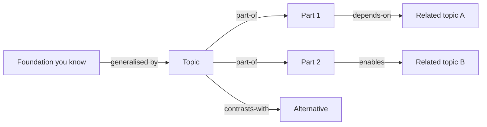

# Stage A — Ground (Steps 1–4)

Goal of this stage: know where the learner starts, why the topic matters, how
it connects to what they know, and where everything sits.

## Step 1 — Calibrate the starting point

- Read the request for clues ("I know REST, explain GraphQL" → foundation = REST).
- If nothing can be inferred and the learner is present, ask **one** question
  with options, e.g. "Which are you comfortable with: (a) A, (b) B, (c) both, (d) neither?"
- If they can't answer now, assume the most likely foundation and state it in one line.
- Pick **one running example** (a realistic scenario, ideally from their
  stack or project) to reuse in every step.
- Create the checkpoint file now (see SKILL.md, Checkpoint protocol).

## Step 2 — Say why it matters

2–3 sentences: the problem the topic solves and what the learner gains.
Lead with the payoff so later details have a purpose to attach to.

## Step 3 — Bridge from the known

> "You already know **[foundation]**. **[Topic]** is [foundation] **plus / applied to / generalised to** [the new part]."

- What **stays the same** from the foundation.
- What is **new or different**.
- One analogy (everyday life or their domain) and **where the analogy breaks**.

## Step 4 — Big-picture map

Show where everything sits before details. Label every edge with a type:

| Link | Meaning |
|---|---|
| is-a | a kind of |
| part-of | a component of |
| depends-on | needs this first |
| enables | makes this possible |
| produces | outputs this |
| contrasts-with | alternative / opposite |

- ≤ 9 nodes; group the rest under "also related".
- One sentence per related topic: what it is and why it is on the map.
- Copy the node list into the checkpoint (`Map nodes`) — later stages refer back to it.

## End of stage A

Update the checkpoint: Status = `stage A done`, Next step = `Stage B — Step 5`.
