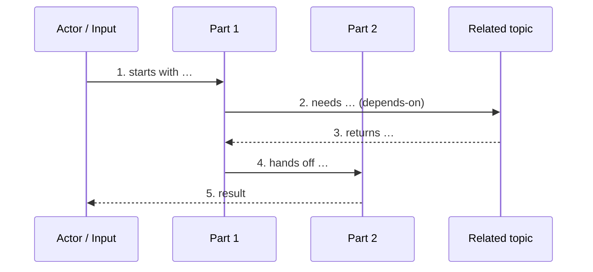

# Stage B — Build (Steps 5–7)

Re-read the checkpoint before starting. Use its running example and map nodes;
do not invent new ones.

## Step 5 — Core, layer by layer

Go foundation → core → advanced. For each layer:

1. **Plain definition** — one sentence, no jargon.
2. **How it works** — the mechanism, 3–5 sentences.
3. **Example** — the running example.
4. **New vs. previous layer** — one line.

Stop at the chosen depth. Name deeper layers only, as "next to learn".
Add each new term to the checkpoint's `Key terms` list.

## Step 6 — Flow of actions

Show how the parts and related topics act **in sequence**: who does what, in
what order, and what passes between them.

- Under the diagram, a numbered list matching the arrows.
- For each step: **what can go wrong** there (feeds Step 9).
- Use a `flowchart` instead when the flow has decisions or branches.
- Participants must be nodes from the Step 4 map.

## Step 7 — Worked example, end to end

Run the running example from start to finish: starting state → each action →
intermediate results → outcome. If the learner has a codebase open, use their
language and framework; keep code short and annotated. Don't invent APIs —
if unsure of an exact signature, say so and point to the official docs.

## End of stage B

Update the checkpoint: Status = `stage B done`, add failure points under
`Pitfalls found`, Next step = `Stage C — Step 8`.
